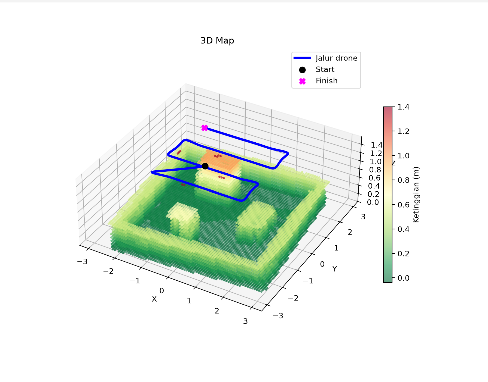
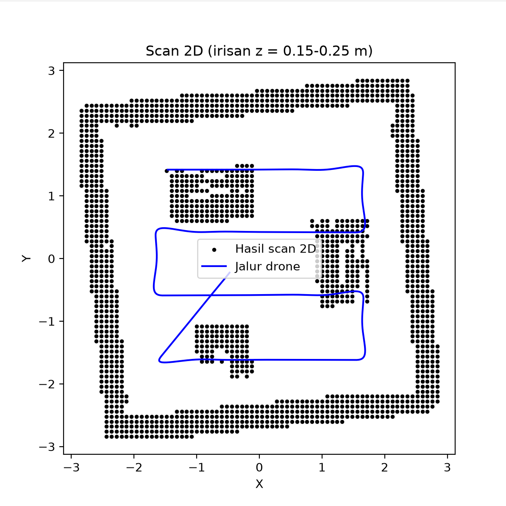

# 3D Mapping Drone di CoppeliaSim Edu

ETS [Sistem Robot Otonom] - [Ahmad Nibras Qolby] ([5022231026])

## Deskripsi
Drone Quadcopter terbang menyapu arena (pola lawnmower) dengan vision sensor depth
yang menunduk 50° dan berputar terhadap badan drone, sehingga ground, badan objek,
dan puncak objek terdeteksi. Point cloud dibangun lewat ZMQ Remote API (Python),
lalu diproses menjadi voxel dan diwarnai berdasarkan ketinggian.

## Tahapan
1. Kontrol drone dan tampilan jalur
2. Scan 2D (irisan horizontal): `2d_scan.png`
3. Scan 3D (point cloud dari depth sensor)
4. Voxel downsampling (post process)
5. Color mapping ketinggian (post process): `3d_map.png`

## Video
- Proses mapping: [https://drive.google.com/file/d/1uB12R227XkSOehzoPdRZZXptkA_bXATi/view?usp=sharing]
- Hasil 3D mapping: [https://drive.google.com/file/d/1_KFlXYimy-zJ5kr19J6E7Xq0QAm0-BzB/view?usp=sharing]

## File
- `drone_3d_mapping.py` : script utama
- `[nama].ttt` : scene CoppeliaSim
- `[nama].lua` : script drone
- `[nama].pdf` : laporan

## Cara menjalankan
1. Buka `.ttt` di CoppeliaSim Edu (jangan di-Play).
2. `pip install numpy matplotlib coppeliasim-zmqremoteapi-client`
3. `python drone_3d_mapping.py`

## Hasil

